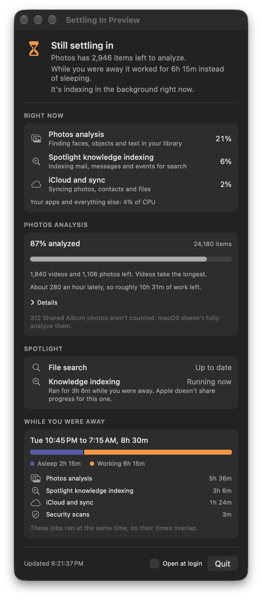

# Settling In

A menu bar app that shows what your Mac is doing in the background.

A new Mac spends its first days analyzing your photo library, building its search index and syncing with iCloud. It does most of this while you're away, often with the lid closed, so all you notice is a warm laptop. macOS doesn't show any of it. Settling In does, in plain language, and tells you when the Mac is done.



## What it shows

- **Status.** "Still settling in" or "Back to normal", with the reasons.
- **Right now.** How much CPU Apple's background jobs are using, with names like "Photos analysis" instead of `mediaanalysisd`.
- **Photos analysis.** How much of your library is analyzed, how many photos and videos are left, and the recent pace. Shared Album photos are listed separately, because macOS doesn't fully analyze them and they would look stuck forever.
- **Spotlight.** Whether file indexing and knowledge indexing are running.
- **While you were away.** How long the Mac slept versus worked during the last stretch you were away from it, and which jobs ran.

## Install

1. Download [Settling-In.dmg](https://github.com/mattbirchler/settling-in/releases/latest/download/Settling-In.dmg) from the latest release.
2. Open it and drag **Settling In** to the Applications folder.
3. Open Settling In from Applications. An hourglass appears in the menu bar.
4. To see Photos progress, turn on Settling In under System Settings > Privacy & Security > Full Disk Access. Everything else works without it.

Requires macOS 26 or later. The app is signed and notarized.

## Privacy

Settling In has no network code. Nothing it reads leaves your Mac.

It reads three things:

- the list of running processes (`ps`)
- the system power log (`pmset -g log`)
- your Photos library's database, opened read-only, to count analyzed items. It never looks at the photos themselves.

Full Disk Access is needed only for the last one, because macOS protects the Photos library.

## Limitations

- Photos progress comes from Photos' private database. Apple doesn't document it, so a macOS update can break that section.
- Only the default library at `~/Pictures/Photos Library.photoslibrary` is read.
- Spotlight's knowledge indexing has no progress counter, so the app can only say whether it's running.
- The "While you were away" section refreshes every 15 minutes, because the power log is slow to read.

## Building from source

You need Xcode 27 and [XcodeGen](https://github.com/yonaskolb/XcodeGen) (`brew install xcodegen`).

```
make build     # build with xcodebuild
make test      # run the SettleCore tests
make run       # build and launch a debug copy
make install   # release build into /Applications, then launch it
```

The project signs to run locally by default, so no developer account is needed. With that signature, macOS asks for Full Disk Access again after each rebuild. To avoid that, sign with your own team: see `Config/Base.xcconfig`.

Launch flags, useful when working on the UI:

- `--preview-window` opens the panel as a regular window
- `--demo` fills the panel with sample data for a Mac that's still settling in
- `--demo-done` does the same for a Mac that has finished

The parsing and data reading live in `Packages/SettleCore`, a Swift package with tests. `App` holds the SwiftUI menu bar app.

## License

MIT. See [LICENSE](LICENSE).
